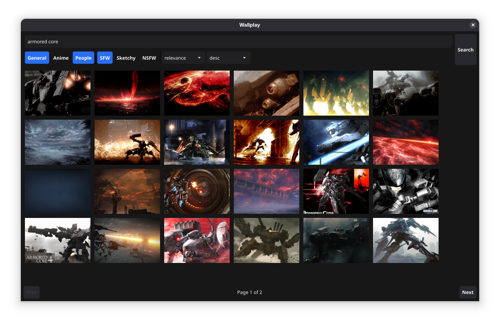
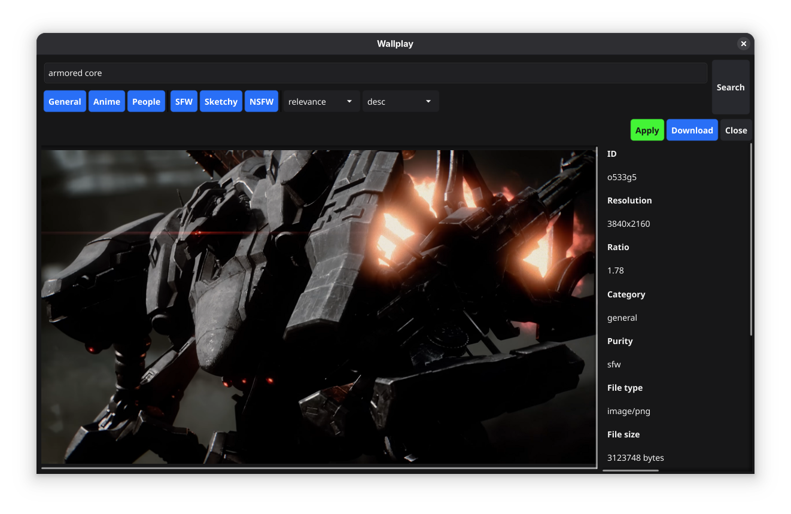

# Deskwall

A desktop wallpaper browser and applier built with Go and [Fyne](https://fyne.io).

Deskwall lets you search [wallhaven.cc](https://wallhaven.cc) for wallpapers,
preview them in a grid, expand individual images with metadata, download them
to your XDG Pictures directory, and apply them as your GNOME wallpaper — all
from a single native app.





## Features

- **Search** wallhaven.cc with filters for categories, purity, sorting, and order
- **Grid view** with asynchronously-loaded thumbnails and pagination
- **Expandable preview** — click a thumbnail to grow the full image with an elastic animation
- **Metadata sidebar** — resolution, category, tags, uploader, and more
- **Download** to the XDG Pictures directory (GNOME/KDE default backgrounds folder)
- **Apply** — download and set as the GNOME wallpaper via `gsettings`
- **Native** — built with Fyne, no web wrapper, no Electron

## Prerequisites

Build dependencies (cgo via GLFW + OpenGL, no GTK headers needed):

```sh
# Debian/Ubuntu
sudo apt install libgl1-mesa-dev libegl1-mesa-dev \
                 libx11-dev libxrandr-dev libxinerama-dev \
                 libxcursor-dev libxi-dev libxxf86vm-dev

# Fedora
sudo dnf install mesa-libGL-devel mesa-libEGL-devel \
                 libX11-devel libXrandr-devel libXinerama-devel \
                 libXcursor-devel libXi-devel libXxf86vm-devel
```

Runtime: `gsettings` (from `dconf-cli` or `gnome-settings-daemon`) for the
Apply feature; the rest needs only the userland GL/X11 libraries.

## Project structure

```
deskwall/
├── main.go                    # Entry point
├── internal/
│   ├── app/                   # Fyne application wiring and lifecycle
│   ├── ui/                    # Fyne windows, widgets, filters, grid, detail view
│   └── wallhaven/             # Wallhaven API client and DTOs
├── assets/                    # Desktop entry, icons
├── docs/                      # Screenshots
├── nfpm.yaml                  # Debian (.deb) packaging config
├── Makefile
└── LICENSE
```

## Build & run

```sh
make run        # build and run
make build      # build binary to dist/
make tidy        # resolve and tidy module dependencies
make fmt         # format code
make vet         # run go vet
make test        # run tests
```

## Debian package

Packaging uses [nfpm](https://nfpm.goreleaser.com/), a single Go binary that
produces `.deb` (and `.rpm`/`.apk`) packages without the full Debian toolchain.

```sh
make install-tools    # installs nfpm
make deb              # builds binary + .deb into dist/
```

Install the resulting package:

```sh
sudo apt install ./dist/deskwall_0.1.0_amd64.deb
```

## License

Copyright (C) 2026 Juan Francisco Giménez Silva

This program is free software: you can redistribute it and/or modify it under
the terms of the GNU General Public License as published by the Free Software
Foundation, either version 3 of the License, or (at your option) any later
version.

This program is distributed in the hope that it will be useful, but WITHOUT ANY
WARRANTY; without even the implied warranty of MERCHANTABILITY or FITNESS FOR A
PARTICULAR PURPOSE. See the [LICENSE](LICENSE) file for details.
